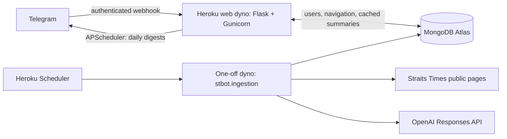

# ST Chat5pt

A Telegram bot that turns public Straits Times articles into six-point news summaries.
Readers browse headlines by section or receive morning, lunchtime, and evening digests.
Premium articles link to the publisher instead of being summarized.

## How it works



The web process serves cached content; opening an article in Telegram does not call
OpenAI. A separate scraper discovers articles, checks modification timestamps,
generates summaries using `gpt-5-mini`, and rebuilds the digest feed. MongoDB stores
articles, subscribers, notification preferences, and each chat's current selection.

The deployment uses **one always-on web dyno with one Gunicorn worker**. Its
APScheduler instance sends digests at approximately **08:06, 12:00, and 19:00
Asia/Singapore**, with up to ten seconds of jitter. Do not increase web dynos or
Gunicorn workers without first moving the digest scheduler into its own singleton
process; otherwise subscribers can receive duplicate digests. A sleeping dyno can
miss scheduled digests.

## Requirements

- Python 3.12; Heroku selects its current patch version using `.python-version`.
- A Telegram bot created with [BotFather](https://core.telegram.org/bots/features#creating-a-new-bot).
- A MongoDB Atlas database user that can read and write the two application databases.
- An OpenAI API key with access to the configured model.
- A Heroku account, an always-on web dyno, and the Heroku Scheduler add-on.

These services require your own accounts and credentials. The source does not
include a shared bot, an existing user list, or preloaded news. Your first article
refresh populates a new database. This project is independent of The Straits Times;
it reads publicly available page content and does not bypass paywalls. Website
layout or access changes can require updates to the scraper.

## Local setup

```sh
python3.12 -m venv .venv
source .venv/bin/activate
python -m pip install -r requirements.txt
cp .env.example .env
chmod 600 .env
```

Fill in `.env`. Local entry points load it without overriding existing environment
variables. Never commit this file.

| Variable | Purpose | Default |
| --- | --- | --- |
| `BOT_TOKEN` | Your Telegram bot's token | Required for the web server and setup |
| `MONGODB_URI` | Your Atlas connection string | Required |
| `OPENAI_API_KEY` | API credential for article summaries | Required for the scraper |
| `PUBLIC_BASE_URL` | This deployment's HTTPS origin, without a path | Required for webhook setup |
| `WEBHOOK_SECRET` | Secret Telegram sends in its webhook authentication header | Required for web/setup |
| `OPENAI_MODEL` | Model used for summaries | `gpt-5-mini` |
| `ARTICLE_DATABASE` | Article database name | `st_articles` |
| `USER_DATABASE` | Subscriber database name | `user_base` |
| `NOTIFICATIONS_ENABLED` | Start the daily digest scheduler (`true`/`false`) | `true` |
| `ADMIN_USER_IDS` | Comma-separated numeric Telegram IDs allowed to use `/seecurrentusers` | Disabled if empty |

Generate a webhook secret with:

```sh
python -c "import secrets; print(secrets.token_urlsafe(32))"
```

The web app listens on `/telegram/webhook` and requires the
`X-Telegram-Bot-Api-Secret-Token` header. `GET /` and `GET /healthz` are liveness
checks; they do not register or change the webhook. Run the server locally with:

```sh
gunicorn 'stbot.web:create_app()' --workers 1 --threads 4 --bind 127.0.0.1:5000
```

For end-to-end local testing, expose that port through an HTTPS tunnel, set its
origin as `PUBLIC_BASE_URL`, and run `python -m stbot.setup`. Use a separate test
bot: Telegram supports a single webhook URL per bot. To populate the database:

```sh
python -m stbot.ingestion
```

This command calls OpenAI for newly discovered or changed public articles. Premium
articles never call OpenAI. Failed summaries are marked for a later retry.

## Deploy to Heroku

The repository includes a `Procfile`, Python runtime selection, pinned direct
dependencies, and an `app.json` manifest. No application-code edits are needed.

1. Clone the repository and create your own app using the Heroku CLI:

   ```sh
   heroku login
   heroku create your-unique-app-name --stack heroku-24
   heroku buildpacks:set heroku/python
   heroku apps:info
   ```

2. In the new app's **Settings → Config Vars**, add the required variables from
   the table above. Use the actual **Web URL** printed by `heroku apps:info` as
   `PUBLIC_BASE_URL`; newly created Heroku domains can contain a generated suffix.
   Generate a new `WEBHOOK_SECRET`. Do this before the first push: the release
   command validates configuration and registers the webhook.

3. Configure [Atlas network access](https://www.mongodb.com/docs/atlas/security/ip-access-list/)
   so the Heroku dynos can reach the cluster. Heroku's default outbound IP addresses
   are dynamic; choose an Atlas/network arrangement suitable for your deployment.
   Grant the database user access to both `st_articles` and `user_base`, or the
   custom database names configured above.

4. Deploy and start one always-on web dyno:

   ```sh
   git push heroku HEAD:main
   heroku ps:scale web=1
   heroku ps:type web=basic
   heroku logs --tail
   ```

   Heroku's release phase runs `python -m stbot.setup` to create indexes and
   register the authenticated Telegram webhook. A failed setup blocks the release.
   The web process runs Flask under Gunicorn. The source uses the original MongoDB
   database and collection names, so existing article and subscriber data remains
   readable; registration now identifies users by chat ID rather than username.

5. Install Heroku Scheduler if it was not provisioned through `app.json`:

   ```sh
   heroku addons:create scheduler:standard
   heroku addons:open scheduler
   ```

   Add **`python -m stbot.ingestion`**, running **hourly**. The manifest installs the
   add-on but does not create this schedule; that dashboard step is required.
   Each invocation runs in a one-off dyno and exits after refreshing the articles.
   Test the command once and populate the initial news feed:

   ```sh
   heroku run python -m stbot.ingestion
   ```

6. Open your bot in Telegram and send `/start`. Check a news section, open a
   numbered summary, and toggle notifications. An empty database displays a
   preparation message until the first successful scraper run.

Heroku charges for the chosen dynos, including one-off Scheduler runs, and OpenAI
usage is billed separately. Scheduler can occasionally miss a run; the next run
checks the latest articles again. See [Heroku Scheduler](https://devcenter.heroku.com/articles/scheduler),
[Gunicorn deployment](https://devcenter.heroku.com/articles/python-gunicorn), and
[release phases](https://devcenter.heroku.com/articles/release-phase).

## Commands and behavior

- `/start`, `/menu`: browse Singapore, Asia, World, Life, Business, Opinion, and Sport.
- `/1`–`/9`: read a summary from the most recently displayed list.
- **Turn Notif On/Off**: change the chat's daily digest preference; new chats start enabled.
- `/update`: show usage/help information.
- `/seecurrentusers`: subscriber count, restricted to `ADMIN_USER_IDS`.

The old technology/top-story callbacks remain readable for existing Telegram
messages, but are not offered in the current menu. The scraper collects the seven
current sections. No personal profile, donation links, feedback forms, announcement
commands, or one-off retirement tools are part of the application.

## Development

```sh
python -m pip install -r requirements-dev.txt
ruff check .
ruff format --check .
pytest
```

The tests use mocked Telegram/OpenAI clients and an in-memory MongoDB replacement.
They do not read local credentials, change a live database, or send Telegram messages.
GitHub Actions runs the same checks.

| Path | Responsibility |
| --- | --- |
| `stbot/config.py` | Environment configuration and section definitions |
| `stbot/database.py` | MongoDB access, indexes, feed refresh, and scraper lease |
| `stbot/bot.py` | Telegram menus, summaries, preferences, and digests |
| `stbot/web.py` | WSGI factory, webhook authentication, and scheduler lifecycle |
| `stbot/ingestion.py` | Scheduled scraper CLI, article extraction, and OpenAI summaries |
| `stbot/setup.py` | Deployment initialization and webhook registration |

The scraper retains the original behavior of removing the oldest 20% of article
records if Atlas reports its storage quota is exceeded, then retries the write.
It does not remove subscriber records. A one-hour MongoDB lease prevents ordinary
overlapping hourly scraper invocations; schedule a longer interval if a refresh
takes longer than an hour. Article and digest errors log exception types, not
credentials, user profiles, or full request URLs.

## Publishing a previously private copy

The ignore rules exclude local credentials, Python environments, bytecode, and
development caches. Heroku's slug exclusions also omit tests, CI configuration,
and development-only documentation and dependencies. Notebooks, exports, retirement
materials, and delivery receipts are not included in this source tree.
Ignoring a file does not remove it from older commits: if credentials
ever existed in a repository's history, publish a clean source snapshot into a new
repository rather than pushing that old history, and rotate the old credentials
with their providers. Removing a secret from the latest source is not revocation.

The API integration follows the [OpenAI text-generation documentation](https://platform.openai.com/docs/guides/text)
and uses the existing six-point prompt and `response.output_text`.
