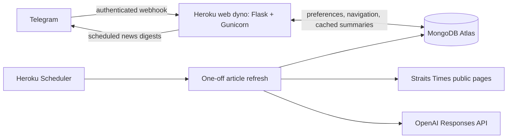

# ST Chat5pt

**An independently built AI news service with 600+ registered Telegram users.**

I owned product scope, Python implementation, AI integration, and deployment.
The service turns public news articles into six-point summaries, with section
menus, source links, and three daily Telegram digests.

> The original hosted bot is scheduled to retire on **24 October 2026**.
> This repository contains a cleaned-up version for inspection and self-hosting.

## Contents

- [Problem and product](#problem-and-product)
- [Product decisions](#product-decisions)
- [Architecture](#architecture)
- [Adoption](#adoption)
- [Cost to run](#cost-to-run)
- [Quality and next steps](#quality-and-next-steps)
- [Run your own instance](#run-your-own-instance)
- [Code and development](#code-and-development)

## Problem and product

As a public-sector officer, I needed to follow current affairs and prepare timely
updates for decision-makers. Inbox alerts, lengthy articles, and manual filtering
made that harder than it needed to be.

I built for my own workflow first, with Singapore public-sector officers as an
accessible initial audience. Readers choose a news section, scan up to nine
headlines, and tap a number for a summary. Optional morning, lunchtime, and evening
digests make checking the news part of an existing Telegram routine.

## Product decisions

The project was **self-funded and built independently**, so scope, adoption, and
operating effort mattered alongside technical feasibility.

| Consideration | Decision |
| --- | --- |
| **Desirability** | Start with a concrete news-monitoring problem and reduce the effort of scanning and filtering articles. |
| **Feasibility** | Use familiar Python libraries, Telegram's existing interface, and managed hosting and storage to deliver the service myself. |
| **Viability** | Automate article refreshes and share cached summaries across readers to control model spend and maintenance effort. |

Telegram reduced the need to build and distribute a separate frontend. Heroku and
MongoDB Atlas kept infrastructure manageable. The initial product tested a focused
reading workflow within a broader opportunity for professional news intelligence.

## Architecture



The Python pipeline uses Beautiful Soup for extraction and OpenAI for summarisation.
Early versions used browser automation; the current source uses the Responses API.

- **Prepare once, serve many:** summarise new or updated articles, then reuse stored
  results. Reader selections do not trigger model calls; freshness follows the refresh schedule.
- **Separate processing from delivery:** scheduled ingestion prepares content while
  the Flask webhook serves cached summaries. Failed summaries are retried on a later refresh.
- **Persist reader state:** MongoDB stores preferences and selections across restarts;
  chat IDs identify subscribers independently of usernames.
- **Respect source access:** include original links and show subscription notices for
  premium articles, without sending them to OpenAI or bypassing paywalls.

See the [article pipeline](stbot/ingestion.py), [Telegram experience](stbot/bot.py),
[persistence layer](stbot/database.py), and [webhook application](stbot/web.py).

## Adoption

Production MongoDB snapshot on **18 October 2026**:

| Measure | Count |
| --- | ---: |
| Registered individual Telegram accounts | **603** |
| Individual chats with digests enabled | **537** |

Counts use distinct private chat/user IDs, excluding duplicates and two group chats.
One chat with conflicting legacy preferences is excluded from the enabled count.
Notifications default to on. These are registrations and saved settings; activity,
article clicks, retention, and successful delivery were not measured.

## Cost to run

Approximate spend at the original bot's workload, using a 30-day month:

| Component | Basis | Monthly cost (USD) |
| --- | --- | ---: |
| OpenAI API (`gpt-5-mini`) | US$0.80/day × 30 | US$24 |
| Heroku hosting and dyno usage | Reported monthly spend | US$8 |
| **Total for API and hosting** | | **US$32** |

Based on my reported spend; actual costs vary with article volume, model choice,
and hosting usage. Any database charges or taxes are additional.

## Quality and next steps

The current source has **36 automated tests** plus CI lint and formatting checks,
covering extraction, caching, retries, preferences, navigation, and webhook security.
Tests use mocked services; they establish application behaviour, while summary
factuality still needs a human-reviewed benchmark. See the
[pipeline checks](tests/test_ingestion.py) and [bot checks](tests/test_bot.py).

The operating model uses one always-on web dyno and one Gunicorn worker to avoid
duplicate digests. Publisher layout changes and missed scheduled runs remain
practical limitations; deployment and recovery details follow below.

My next priorities would be summary-quality evaluation and usage measurement before
expanding scope. The wider vision was personalised news intelligence: topic/country
filters, searchable digest archives, authorised custom feeds, cross-article reports,
and email or dashboard delivery. These remain future ideas.

## Run your own instance

The source is configured for the same Heroku-based architecture. Bring your own
Telegram bot, database, and OpenAI credentials; the setup below covers the initial
feed refresh, webhook registration, and scheduled article updates.

<details>
<summary><strong>Requirements, local setup, and Heroku deployment</strong></summary>

## Requirements

- Python 3.12; Heroku selects its current patch version using `.python-version`.
- A Telegram bot created with [BotFather](https://core.telegram.org/bots/features#creating-a-new-bot).
- A MongoDB Atlas database user that can read and write the two application databases.
- An OpenAI API key with access to the configured model.
- A Heroku account, an always-on web dyno, and the Heroku Scheduler add-on.

These services require your own accounts and credentials. The source does not
include a shared bot, an existing user list, or preloaded news. Your first article
refresh populates a new database. This project is independent of The Straits Times;
it reads publicly available page content and does not bypass paywalls. Website
layout or access changes can require updates to the scraper.

## Local setup

```sh
python3.12 -m venv .venv
source .venv/bin/activate
python -m pip install -r requirements.txt
cp .env.example .env
chmod 600 .env
```

Fill in `.env`. Local entry points load it without overriding existing environment
variables. Never commit this file.

| Variable                | Purpose                                                                | Default                               |
| ----------------------- | ---------------------------------------------------------------------- | ------------------------------------- |
| `BOT_TOKEN`             | Your Telegram bot's token                                              | Required for the web server and setup |
| `MONGODB_URI`           | Your Atlas connection string                                           | Required                              |
| `OPENAI_API_KEY`        | API credential for article summaries                                   | Required for the scraper              |
| `PUBLIC_BASE_URL`       | This deployment's HTTPS origin, without a path                         | Required for webhook setup            |
| `WEBHOOK_SECRET`        | Secret Telegram sends in its webhook authentication header             | Required for web/setup                |
| `OPENAI_MODEL`          | Model used for summaries                                               | `gpt-5-mini`                          |
| `ARTICLE_DATABASE`      | Article database name                                                  | `st_articles`                         |
| `USER_DATABASE`         | Subscriber database name                                               | `user_base`                           |
| `NOTIFICATIONS_ENABLED` | Start the daily digest scheduler (`true`/`false`)                      | `true`                                |
| `ADMIN_USER_IDS`        | Comma-separated numeric Telegram IDs allowed to use `/seecurrentusers` | Disabled if empty                     |

Generate a webhook secret with:

```sh
python -c "import secrets; print(secrets.token_urlsafe(32))"
```

The web app listens on `/telegram/webhook` and requires the
`X-Telegram-Bot-Api-Secret-Token` header. `GET /` and `GET /healthz` are liveness
checks; they do not register or change the webhook. Run the server locally with:

```sh
gunicorn 'stbot.web:create_app()' --workers 1 --threads 4 --bind 127.0.0.1:5000
```

For end-to-end local testing, expose that port through an HTTPS tunnel, set its
origin as `PUBLIC_BASE_URL`, and run `python -m stbot.setup`. Use a separate test
bot: Telegram supports a single webhook URL per bot. To populate the database:

```sh
python -m stbot.ingestion
```

This command calls OpenAI for newly discovered or changed public articles. Premium
articles never call OpenAI. Failed summaries are marked for a later retry.

## Deploy to Heroku

The repository includes a `Procfile`, Python runtime selection, pinned direct
dependencies, and an `app.json` manifest. No application-code edits are needed.

1. Clone the repository and create your own app using the Heroku CLI:

   ```sh
   heroku login
   heroku create your-unique-app-name --stack heroku-24
   heroku buildpacks:set heroku/python
   heroku apps:info
   ```

2. In the new app's **Settings → Config Vars**, add the required variables from
   the table above. Use the actual **Web URL** printed by `heroku apps:info` as
   `PUBLIC_BASE_URL`; newly created Heroku domains can contain a generated suffix.
   Generate a new `WEBHOOK_SECRET`. Do this before the first push: the release
   command validates configuration and registers the webhook.

3. Configure [Atlas network access](https://www.mongodb.com/docs/atlas/security/ip-access-list/)
   so the Heroku dynos can reach the cluster. Heroku's default outbound IP addresses
   are dynamic; choose an Atlas/network arrangement suitable for your deployment.
   Grant the database user access to both `st_articles` and `user_base`, or the
   custom database names configured above.

4. Deploy and start one always-on web dyno:

   ```sh
   git push heroku HEAD:main
   heroku ps:scale web=1
   heroku ps:type web=basic
   heroku logs --tail
   ```

   Heroku's release phase runs `python -m stbot.setup` to create indexes and
   register the authenticated Telegram webhook. A failed setup blocks the release.
   The web process runs Flask under Gunicorn. The source uses the original MongoDB
   database and collection names, so existing article and subscriber data remains
   readable; registration now identifies users by chat ID rather than username.

   Daily digests run at approximately **08:06, 12:00, and 19:00 Asia/Singapore**,
   with up to ten seconds of jitter. Keep one web dyno and one Gunicorn worker;
   multiple scheduler instances can send duplicate digests.

5. Install Heroku Scheduler if it was not provisioned through `app.json`:

   ```sh
   heroku addons:create scheduler:standard
   heroku addons:open scheduler
   ```

   Add **`python -m stbot.ingestion`**, running **hourly**. The manifest installs the
   add-on but does not create this schedule; that dashboard step is required.
   Each invocation runs in a one-off dyno and exits after refreshing the articles.
   Test the command once and populate the initial news feed:

   ```sh
   heroku run python -m stbot.ingestion
   ```

6. Open your bot in Telegram and send `/start`. Check a news section, open a
   numbered summary, and toggle notifications. An empty database displays a
   preparation message until the first successful scraper run.

Heroku charges for the chosen dynos, including one-off Scheduler runs, and OpenAI
usage is billed separately. Scheduler can occasionally miss a run; the next run
checks the latest articles again. See [Heroku Scheduler](https://devcenter.heroku.com/articles/scheduler),
[Gunicorn deployment](https://devcenter.heroku.com/articles/python-gunicorn), and
[release phases](https://devcenter.heroku.com/articles/release-phase).

## Commands and behavior

- `/start`, `/menu`: browse Singapore, Asia, World, Life, Business, Opinion, and Sport.
- `/1`–`/9`: read a summary from the most recently displayed list.
- **Turn Notif On/Off**: change the chat's daily digest preference; new chats start enabled.
- `/update`: show usage/help information.
- `/seecurrentusers`: subscriber count, restricted to `ADMIN_USER_IDS`.

The old technology/top-story callbacks remain readable for existing Telegram
messages, but are not offered in the current menu. The scraper collects the seven
current sections. No personal profile, donation links, feedback forms, announcement
commands, or one-off retirement tools are part of the application.

</details>

## Code and development

<details>
<summary><strong>Development setup, source map, and operating details</strong></summary>

```sh
python -m pip install -r requirements-dev.txt
ruff check .
ruff format --check .
pytest
```

The tests use mocked Telegram/OpenAI clients and an in-memory MongoDB replacement.
They do not read local credentials, change a live database, or send Telegram messages.
GitHub Actions runs the same checks.

| Path                 | Responsibility                                                  |
| -------------------- | --------------------------------------------------------------- |
| `stbot/config.py`    | Environment configuration and section definitions               |
| `stbot/database.py`  | MongoDB access, indexes, feed refresh, and scraper lease        |
| `stbot/bot.py`       | Telegram menus, summaries, preferences, and digests             |
| `stbot/web.py`       | WSGI factory, webhook authentication, and scheduler lifecycle   |
| `stbot/ingestion.py` | Scheduled scraper CLI, article extraction, and OpenAI summaries |
| `stbot/setup.py`     | Deployment initialization and webhook registration              |

The scraper retains the original behavior of removing the oldest 20% of article
records if Atlas reports its storage quota is exceeded, then retries the write.
It does not remove subscriber records. A one-hour MongoDB lease prevents ordinary
overlapping hourly scraper invocations; schedule a longer interval if a refresh
takes longer than an hour. Article and digest errors log exception types, not
credentials, user profiles, or full request URLs.

</details>
